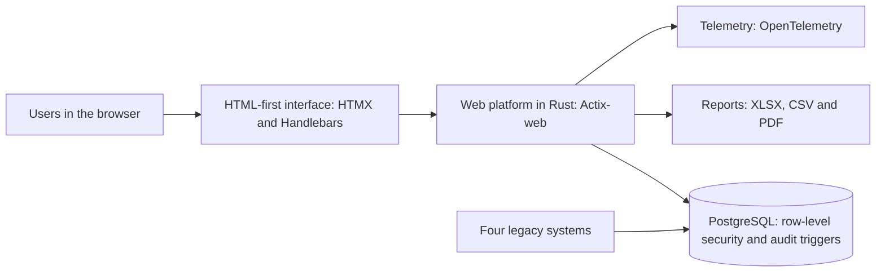

# Unified CRM platform in Rust: case study

> **Private code.** The source code belongs to the client and is not published. This repository is a case study: it describes the project at a high level, with no code, no screenshots and no internal details.

| | |
| --- | --- |
| **Client** | Confidential |
| **Period** | 2025 to present |
| **Status** | In production, under active development |
| **Live** | [unified.circlemsp.com](https://unified.circlemsp.com) |

## Context

Customer, opportunity, contract and quoting data was spread across four legacy internal systems.

## My role

I work on the platform as a programmer, as part of a team. My work includes the forecast and activity dashboards, built on PostgreSQL functions, with report exports and automated tests.

## Architecture

- One web platform unifies the data of four legacy systems into a single CRM, sales and quoting experience: companies, contacts, opportunities, proposals and activities.
- The interface is HTML-first: Handlebars templates updated with HTMX.
- Access is role-based and enforced in the database with row-level security.
- PostgreSQL triggers keep an automatic audit trail.

## Key features

- Companies, contacts, opportunities and proposals
- Activity logging and follow-ups
- Forecast and KPI dashboards
- Role-based access with row-level security
- Automatic audit trail through PostgreSQL triggers
- Report export (XLSX, CSV, PDF)

## Stack

Rust · Actix-web · PostgreSQL · SQLx · HTMX · Handlebars · Docker · OpenTelemetry

## Results

In production and under active development: CRM, sales and quoting live in one platform, with forecast and activity dashboards and an automatic audit trail.
